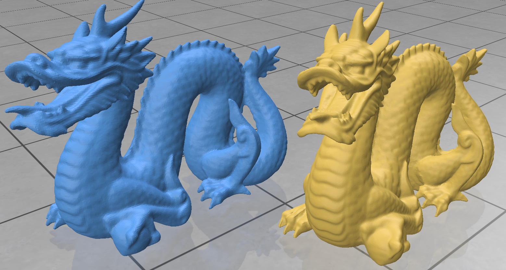

# Neural SDF

A PyTorch implementation of a neural signed distance function that fits a single 3D mesh. An MLP with Fourier positional encodings is trained with clamped L1 loss on ground truth SDF samples.
Additionally, it is regularized with eikonal, Neumann and on-surface constraints. The resulting mesh is extracted using marching cubes.


*Blue: neural SDF reconstruction. Yellow: ground-truth mesh.*

I built this project in my spare time to practice machine learning and shape analysis. 
I am pleased with the result and learned a lot along the way, including from the papers I relied on, which are listed below.

I started from the basic MLP architecture introduced in DeepSDF and kept adding improvements, 
of which the most impactful were extra loss terms and positional encodings. The final model
reconstructs the Stanford dragon with a Chamfer distance of 0.0035 (unit sphere coordinates).

My next goal is to train an autoencoder on many shapes, to learn a latent space of shapes, and then apply flow matching on top of it.

## Usage

Requires [uv](https://docs.astral.sh/uv/) and a CUDA GPU for training.

```bash
uv sync
uv run neural-sdf train --mesh dragon     # trains, saves models/dragon.pt, then displays
uv run neural-sdf display --mesh dragon   # displays an existing model
```

`--mesh` takes `bunny` (default) or `dragon`. On first use, the mesh is downloaded from the Stanford 3D Scanning Repository and repaired into a watertight mesh with pymeshlab.

## References

- Park et al., *DeepSDF: Learning Continuous Signed Distance Functions for Shape Representation*
- Sitzmann et al., *Implicit Neural Representations with Periodic Activation Functions* (SIREN)
- Tancik et al., *Fourier Features Let Networks Learn High Frequency Functions in Low Dimensional Domains*
- Scan models from the [Stanford 3D Scanning Repository](http://graphics.stanford.edu/data/3Dscanrep/)

